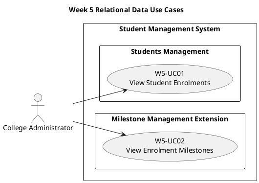

# Week 5 Use-Case Descriptions

## Purpose

Week 5 changes how application data is modelled and persisted.

Replacing an in-memory collection with a relational database does not, by itself, create a new user goal. Use cases describe externally observable behaviour rather than a particular persistence technology.

The core lab therefore introduces one new use case that requires the `Student` to `Enrolment` relationship. Existing Student Management and Academic Supervisor Management use cases continue to apply while their internal data access may be refactored.

## Scope

### Core Use Case

- `W5-UC01`: View Student Enrolments

### Extension Use Case

For students who select **Milestone Management** as the new relational module:

- `W5-UC02`: View Enrolment Milestones

For students who select **Academic Supervisor Management**, use the existing Week 4 use cases, particularly:

- `W4-UC01`: Create Academic Supervisor
- `W4-UC02`: List Academic Supervisors
- `W4-UC03`: View Academic Supervisor Details
- `W4-UC04`: Assign Academic Supervisor to Student
- `W4-UC05`: View Student Supervisory Team

The observable behaviour of those use cases should remain unchanged when their persistence implementation is replaced.

## Use-Case Summary

| Use Case ID | Use Case | Primary Actor | Classification |
|---|---|---|---|
| W5-UC01 | View Student Enrolments | College Administrator | Core |
| W5-UC02 | View Enrolment Milestones | College Administrator | Extension |

## Use-Case Diagram



# Core Use-Case Description

## W5-UC01: View Student Enrolments

**Primary Actor:** College Administrator  
**Classification:** Core

### Goal

View the enrolments recorded for a selected student in chronological order.

### Preconditions

- The Student Management System is available.
- The College Administrator can access Student Management.
- A student number has been selected or supplied.

### Trigger

The College Administrator selects **View Enrolments** for a student.

### Main Success Scenario

1. The system receives the selected student number.
2. The system finds one or more enrolments associated with the student number.
3. The system orders the enrolments by start date, from earliest to latest.
4. The system displays the selected student's number.
5. For each enrolment, the system displays:
   - Programme code
   - Start date
   - Expected end date, where recorded
   - Mode of study
   - Enrolment status
6. The College Administrator reviews the enrolment information.

### Alternative Flow A1: No Enrolments Found

At the step where the system searches for enrolments:

1. No enrolments are associated with the supplied student number.
2. The system displays **No enrolments found**.
3. No Student or Enrolment information is changed.
4. The use case ends.

### Postconditions

#### Success

- The student's available enrolments have been displayed in chronological order.
- No Student or Enrolment information has been changed.

#### No Enrolments Found

- No enrolment information has been displayed.
- No Student or Enrolment information has been changed.
- A **No enrolments found** message has been displayed.

### Business Rules

- An Enrolment belongs to exactly one Student.
- A Student may have zero, one, or several Enrolments.
- Enrolments are displayed from earliest to latest start date.
- A missing expected end date is displayed consistently, for example as **Not recorded**.
- Viewing enrolments must not modify persistent data.

### Design Decisions

Decide:

- Which Student view provides the **View Enrolments** link.
- How dates are formatted.
- How a missing expected end date is displayed.
- Whether the page displays the student's name as well as their number.
- Whether a supplied but unknown student number is distinguished from a known student with no enrolments.

If you introduce a separate **Student Not Found** outcome, document it as an additional alternative flow and apply it consistently to the implementation and diagrams.

### Data Required

The use case requires:

- A student number.
- Enrolments associated with that student number.
- A query that orders matching Enrolments by start date.

The persistence technology is not part of the use-case behaviour. The implementation may use Entity Framework Core and SQLite, but the observable outcome should remain the same if the persistence technology changes.

# Extension Use-Case Description

## W5-UC02: View Enrolment Milestones

**Primary Actor:** College Administrator  
**Classification:** Extension

### Goal

View the milestones associated with a selected enrolment.

### Preconditions

- The Student Management System is available.
- The College Administrator can access Student Management.
- The selected enrolment exists.
- Milestone Management has been implemented.

### Trigger

The College Administrator selects **View Milestones** for an enrolment.

### Main Success Scenario

1. The system receives the selected enrolment identifier.
2. The system finds one or more student milestones associated with the enrolment.
3. The system retrieves the corresponding milestone definitions.
4. The system orders the milestones using the selected ordering rule.
5. For each student milestone, the system displays:
   - Milestone code
   - Milestone title
   - Due date, where recorded
   - Completion date, where recorded
   - Current milestone status
6. The College Administrator reviews the milestone information.

### Alternative Flow A1: No Milestones Found

At the step where the system searches for student milestones:

1. No student milestones are associated with the selected enrolment.
2. The system displays **No milestones found**.
3. No Enrolment or milestone information is changed.
4. The use case ends.

### Postconditions

#### Success

- The milestones associated with the enrolment have been displayed.
- No Enrolment or milestone information has been changed.

#### No Milestones Found

- No milestone information has been displayed.
- No information has been changed.
- A **No milestones found** message has been displayed.

### Business Rules

- A Student Milestone belongs to exactly one Enrolment.
- A Milestone Definition may be used by many Student Milestones.
- The same milestone definition should not be assigned to the same enrolment more than once.
- Missing due and completion dates must be displayed consistently.
- Viewing milestones must not modify persistent data.

### Design Decisions

Decide:

- How milestones are ordered.
- How missing dates are displayed.
- Whether historical progression entries appear on this page or on a separate details page.
- Whether an unknown enrolment is distinguished from an enrolment with no milestones.

If you introduce an **Enrolment Not Found** outcome, document it as an additional alternative flow.

### Data Required

The use case requires relationships among:

```text
Enrolment
    -> StudentMilestone
        -> MilestoneDefinition
```

The use case provides a reason to introduce DAO operations that query related relational data. It does not require a milestone update operation.
