# Week 6 Lab 1: Initial Class Diagram

## Purpose

This initial diagram supports the guided refactoring of:

```text
W5-UC01: View Student Enrolments
```

It provides an architectural skeleton rather than a completed implementation design. It identifies the principal responsibilities, ports, adapters, and permitted dependency directions, while leaving you to decide and implement:

- Final properties and collections.
- Asynchronous method signatures.
- Business DTO fields.
- MVC view-model fields.
- REST response fields.
- Mapping operations.
- Empty-result handling.
- Exact namespaces and registration classes.

You will revise and complete the diagram during Lab 2 so that it represents your actual implementation.

## PlantUML

```plantuml
@startuml Week06_Lab1_Initial_Class_Diagram

title Week 6 Lab 1: Initial Class Diagram for W5-UC01

skinparam packageStyle rectangle
skinparam classAttributeIconSize 0
skinparam shadowing false
skinparam linetype ortho
hide empty attributes
hide empty methods

package "PgrStudentManagement.Domain" <<Project>> {
    package "Students" {
        class Student <<Domain Entity>>
        class Enrolment <<Domain Entity>>
        enum EnrolmentStatus <<Domain Enumeration>>

note top of Student
Only classes and relationships relevant to
W5-UC01 are shown.

Retain business state and behaviour required
by existing use cases.
end note
    }
}

package "PgrStudentManagement.Business" <<Project>> {
    package "Students.ViewStudentEnrolments" {
        interface IViewStudentEnrolmentsUseCase <<Input Port>>
        class ViewStudentEnrolmentsUseCase <<Use Case>>
        class ViewStudentEnrolmentsInput <<Input DTO>>
        class StudentEnrolmentsOutput <<Output DTO>>
note bottom of IViewStudentEnrolmentsUseCase
Input port used by MVC and REST adapters.

Students must define the final asynchronous
method signature.
end note

note bottom of StudentEnrolmentsOutput
The final output DTO structure is not supplied.
Define the data required by W5-UC01.
end note
    }

    package "Students.Gateway" {
        interface IEnrolmentGateway <<Output Port>>
note bottom of IEnrolmentGateway
Output port owned by Business.

Students must define the final asynchronous
method signature.
end note
    }
}

package "PgrStudentManagement.Adapters.Persistence" <<Project>> {
    package "Relational" {
        class StudentManagementDbContext <<EF Core DbContext>>
    }

    package "Relational.Models" {
        class StudentRecord <<Persistence Record>>
        class EnrolmentRecord <<Persistence Record>>
    }

    package "Relational.Gateway" {
        class EfEnrolmentGateway <<Persistence Adapter>>
    }

    package "Relational.Mappers" {
        class EnrolmentPersistenceMapper <<Mapper>>
note bottom of EnrolmentPersistenceMapper
Add only mappings required by the implemented
use case. Avoid unused operations.
end note
    }
}

package "PgrStudentManagement.Adapters.Web" <<Razor Class Library>> {
    class StudentsController <<MVC Controller>>
    class StudentEnrolmentsViewModel <<MVC View Model>>
    class StudentEnrolmentsWebMapper <<Web Mapper>>
    class "Views/Students/Enrolments.cshtml" as EnrolmentsView <<Razor View>>
note bottom of StudentEnrolmentsViewModel
Define presentation-ready fields required by
the Razor view, including missing-value display.
end note
}

package "PgrStudentManagement.Adapters.API" <<Project>> {
    class StudentsApiController <<REST Controller>>
    class StudentEnrolmentsResponse <<API Response>>
    class StudentEnrolmentsApiMapper <<API Mapper>>
note bottom of StudentEnrolmentsResponse
Define the external REST response independently
from MVC and persistence models.
end note
}

package "PgrStudentManagement.Application" <<Executable Host>> {
    class Program <<Composition Root>>
note top of Program
PgrStudentManagement.Application is the only
executable project and composes the adapters.
end note
}

Student "1" .. "0..*" Enrolment : conceptual relationship
Enrolment --> EnrolmentStatus : uses

ViewStudentEnrolmentsUseCase ..|> IViewStudentEnrolmentsUseCase
ViewStudentEnrolmentsUseCase --> IEnrolmentGateway : requests Enrolment data
ViewStudentEnrolmentsUseCase ..> ViewStudentEnrolmentsInput : accepts
ViewStudentEnrolmentsUseCase ..> StudentEnrolmentsOutput : returns

EfEnrolmentGateway ..|> IEnrolmentGateway
EfEnrolmentGateway --> StudentManagementDbContext
EfEnrolmentGateway --> EnrolmentPersistenceMapper
EnrolmentPersistenceMapper ..> EnrolmentRecord : reads
EnrolmentPersistenceMapper ..> Enrolment : creates
StudentManagementDbContext "1" o-- "0..*" StudentRecord
StudentManagementDbContext "1" o-- "0..*" EnrolmentRecord

StudentsController --> IViewStudentEnrolmentsUseCase
StudentsController --> StudentEnrolmentsWebMapper
StudentEnrolmentsWebMapper ..> StudentEnrolmentsOutput
StudentEnrolmentsWebMapper ..> StudentEnrolmentsViewModel
StudentsController ..> EnrolmentsView : returns
EnrolmentsView ..> StudentEnrolmentsViewModel : displays

StudentsApiController --> IViewStudentEnrolmentsUseCase
StudentsApiController --> StudentEnrolmentsApiMapper
StudentEnrolmentsApiMapper ..> StudentEnrolmentsOutput
StudentEnrolmentsApiMapper ..> StudentEnrolmentsResponse

Program ..> ViewStudentEnrolmentsUseCase : registers
Program ..> EfEnrolmentGateway : registers
Program ..> StudentsController : loads Web adapter
Program ..> StudentsApiController : loads API adapter

note on link #lightyellow
Conceptual relationship.
Represent it according to the implemented
Domain design, such as an identifier-based
relationship or an Enrolment collection.
end note

legend right
    |= Stereotype |= Responsibility |
    | Domain Entity | Business concept and rules |
    | Input Port | How an incoming adapter invokes Business |
    | Output Port | External capability required by Business |
    | Persistence Adapter | Technology-specific port implementation |
    | MVC / REST Model | Adapter-specific representation |
endlegend

@enduml
```



## Reading the Diagram

- `IViewStudentEnrolmentsUseCase` is the **input port** used by the MVC and REST adapters.
- `IEnrolmentGateway` is the Business-owned **output port** used to request Enrolment data.
- `EfEnrolmentGateway` is an outgoing persistence adapter that implements the output port.
- MVC and REST use separate adapter models and mappers.
- Persistence records remain separate from Domain entities.
- `PgrStudentManagement.Application` is the only executable project and the composition root.
