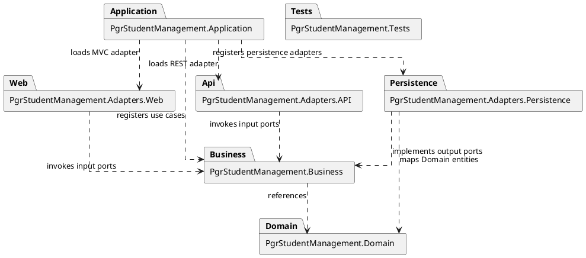

# Week 6 Lab 2: Model the Clean Architecture Implementation

## Purpose

In Lab 1, you refactored:

```text
W5-UC01: View Student Enrolments
```

into the supplied Clean Architecture project structure and exposed the same Business use case through MVC and REST adapters.

In this two-hour lab, you will model the architecture you implemented.

You will create:

1. A project dependency diagram.
2. A C4 Component diagram.
3. An implementation class diagram for `W5-UC01`.
4. An MVC sequence diagram for `W5-UC01`.
5. A REST sequence diagram for `W5-UC01`.

The diagrams must represent your source code. Use the supplied initial class diagram as a starting skeleton, but complete and correct it to match your implementation.

## Learning Outcomes

By completing this lab, you should be able to:

- Model .NET project references and Clean Architecture dependency directions.
- Distinguish project structure from runtime components.
- Create an implementation class diagram showing ports, adapters, models, and mappings.
- Create MVC and REST sequence diagrams that invoke the same Business use case.
- Check consistency among use cases, source code, project references, and diagrams.

## Existing Use Case

Week 6 introduces no new use case for the core lab.

Refer to:

```text
week05-lab1-use-cases.md
```

Model your implementation of:

```text
W5-UC01: View Student Enrolments
```

Preserve its actor, main scenario, **No Enrolments Found** flow, chronological ordering rule, required information, and read-only postconditions.

## Required Starting Point

Start from your completed Week 6 Lab 1 solution.

It should contain:

```text
PgrStudentManagement.Domain
PgrStudentManagement.Business
PgrStudentManagement.Adapters.Persistence
PgrStudentManagement.Adapters.Web
PgrStudentManagement.Adapters.API
PgrStudentManagement.Application
PgrStudentManagement.Tests
```

Before modelling, run:

```bash
dotnet build
dotnet test
dotnet run --project PgrStudentManagement.Application
```

Confirm that `W5-UC01` works through:

- MVC and Razor.
- REST and JSON.

Create a checkpoint:

```bash
git status
git add .
git commit -m "Preserve working Week 6 Lab 1 implementation"
```

## Supplied Material

Use the initial class diagram provided in the lab 1: `week06-lab1-initial-class-diagram.md`.
This initial class diagram is incomplete by design. Remove elements that do not exist in your source code and add implementation details that were omitted.

# Part 1: Inspect the Implementation

## Task 1: Create an Implementation Inventory

For each production project, record:

```text
Project:
Responsibility:
Project references:
Main namespaces:
Classes used by W5-UC01:
Framework dependencies:
```

Confirm:

```text
Domain
    has no production project references

Business
    references Domain only

Persistence Adapter
    references Business and Domain

Web Adapter
    references Business
    and references Domain only if required by implemented code

API Adapter
    references Business
    and references Domain only if required by implemented code

Application
    references Business and all adapter projects
```

Correct any prohibited project reference before continuing.

## Task 2: Trace W5-UC01 Through Both Incoming Adapters

Trace the actual runtime path for:

```text
MVC request
REST request
```

A typical path is:

```text
Incoming controller
    -> adapter mapper
        -> Business input port
            -> Business use-case implementation
                -> Business output port
                    -> EF gateway at runtime
                        -> persistence mapper
                            -> SQLite
```

Record:

- Incoming controller.
- MVC view model or API response model.
- Adapter mapper.
- Business input DTO.
- Input-port interface.
- Use-case implementation.
- Output DTO.
- Output-port interface.
- Concrete EF gateway.
- Persistence record.
- Persistence mapper.
- `DbContext`.
- SQLite database.

Use this inventory to verify every later diagram.

# Part 2: Project and Component Diagrams

## Task 3: Create the Project Dependency Diagram

Create a PlantUML package diagram showing:

```text
PgrStudentManagement.Domain
PgrStudentManagement.Business
PgrStudentManagement.Adapters.Persistence
PgrStudentManagement.Adapters.Web
PgrStudentManagement.Adapters.API
PgrStudentManagement.Application
PgrStudentManagement.Tests
```

Show actual `.csproj` references using dashed dependency arrows from the referencing project to the referenced project.

Use this starting point and remove or add packages/arrows to match your source:



Do not show Web-to-Domain or API-to-Domain references unless they exist in the corresponding project files.

Check that:

- Business does not reference an adapter.
- Adapter projects do not reference one another.
- Application is the outer composition root.

## Task 4: Create the C4 Component Diagram

Create a C4 Component diagram for the implemented core architecture.

Show:

- Browser.
- REST client.
- MVC and Razor Adapter.
- REST API Adapter.
- Business Use Cases.
- Domain Model.
- Relational Persistence Adapter.
- SQLite.
- `PgrStudentManagement.Application` as the executable boundary or host.

The six .NET projects are not six C4 containers. They compile into assemblies that run inside one ASP.NET Core application process.

Your diagram should communicate:

```text
Browser
    -> MVC and Razor Adapter
        -> Business Use Cases

REST Client
    -> REST API Adapter
        -> Business Use Cases

Business Use Cases
    -> Business-owned output port
        -> Relational Persistence Adapter at runtime
            -> SQLite

Business Use Cases
    -> Domain Model
```

Do not draw:

```text
MVC Controller -> DbContext
REST Controller -> EfEnrolmentGateway
Business -> Concrete Persistence Gateway
Web Adapter -> Persistence Adapter
API Adapter -> Persistence Adapter
```

You can find one example of C4 Component Diagram in this [link](https://crashedmind.github.io/PlantUMLHitchhikersGuide/C4/C4Stdlib.html#component).

### Project Diagram versus C4 Component Diagram

The project dependency diagram answers:

```text
Which .NET projects reference which other projects?
```

The C4 Component diagram answers:

```text
Which major runtime responsibilities collaborate inside the deployed application?
```

# Part 3: Implementation Class Diagram

## Task 5: Complete the W5-UC01 Class Diagram

Copy the supplied initial diagram and complete it to match your implementation.

Group classes by project.

### Domain

Include implemented types such as:

- `Student`, where used.
- `Enrolment`.
- `EnrolmentStatus`.

Show only implemented properties and relationships relevant to the use case.

### Business

Include:

- `IViewStudentEnrolmentsUseCase` as the input port.
- `ViewStudentEnrolmentsUseCase`.
- Input DTO.
- Output DTO and item DTO.
- `IEnrolmentGateway` as the output port.

### Persistence Adapter

Include:

- `StudentManagementDbContext`.
- `StudentRecord`, where used.
- `EnrolmentRecord`.
- `EfEnrolmentGateway`.
- `EnrolmentPersistenceMapper`.

### Web Adapter

Include:

- `StudentsController`.
- `StudentEnrolmentsViewModel`.
- Item view model.
- Web mapper.
- Razor view as a boundary or note.

### API Adapter

Include:

- `StudentsApiController`.
- `StudentEnrolmentsResponse`.
- Item response.
- API mapper.

### Application

Include:

- `Program` or another composition-root element.
- Registration extensions only where they exist and are important.

Show:

- Interface implementation.
- Constructor dependencies.
- Exact asynchronous method signatures.
- Mapper input and output types.
- Implemented collections and multiplicities.
- Composition-root registrations where relevant.

Do not include generated framework methods or classes that do not exist.

## Task 6: Review the Class Diagram Against the Dependency Rule

Use the diagram and source code to answer:

1. Does any Domain class depend on an outer project?
2. Does any Business class mention EF Core, SQLite, MVC, or REST types?
3. Does Business own both the input port and output port?
4. Does the EF gateway implement the Business-owned output port?
5. Are Domain entities separate from EF records?
6. Are Business DTOs separate from MVC and API models?
7. Do Web and API avoid direct Persistence dependencies?
8. Does Application construct the runtime graph?

If source and diagram disagree, correct the source or the diagram before continuing.

# Part 4: Sequence Diagrams

## Task 7: Create the MVC Sequence Diagram

Create a sequence diagram for `W5-UC01: View Student Enrolments` through MVC

Use participants matching your source, such as:

```text
College Administrator
Browser
StudentsController
StudentEnrolmentsWebMapper
IViewStudentEnrolmentsUseCase
ViewStudentEnrolmentsUseCase
IEnrolmentGateway
EfEnrolmentGateway
EnrolmentPersistenceMapper
StudentManagementDbContext
SQLite
Razor View
```

Show:

1. Browser request containing the student number.
2. Creation of the Business input DTO.
3. Invocation of the input port and use case.
4. Invocation of the output port.
5. Runtime dispatch to the EF gateway.
6. Read-only EF query, optionally ordered for efficiency.
7. Mapping from persistence records to Domain entities.
8. Business enforcement of earliest-to-latest ordering.
9. Mapping from Domain entities to Business output DTOs.
10. Mapping from Business output to MVC view model.
11. Razor rendering and HTML response.

Add an `alt` fragment for:

```text
No Enrolments Found
```

Do not show the Razor view initiating the controller call. The browser sends the request to the controller, and the controller later supplies the view model to the view.

## Task 8: Create the REST Sequence Diagram

Create a sequence diagram for `W5-UC01: View Student Enrolments` through REST.

Use participants matching your implementation, such as:

```text
REST Client
StudentsApiController
StudentEnrolmentsApiMapper
IViewStudentEnrolmentsUseCase
ViewStudentEnrolmentsUseCase
IEnrolmentGateway
EfEnrolmentGateway
EnrolmentPersistenceMapper
StudentManagementDbContext
SQLite
```

Show:

1. GET request and route value.
2. Creation of the same Business input DTO.
3. Invocation of the same input port and use case.
4. The same output-port and persistence path.
5. Business enforcement of chronological ordering.
6. Mapping of the Business output to the API response.
7. JSON and HTTP response.

Add an `alt` fragment for the empty-result flow.

For the core implementation, show:

```text
200 OK with an empty Enrolments array
```

when no Enrolments match.

# Part 5: Consistency Review

## Task 9: Compare the MVC and REST Sequences

Create a short comparison.

### Shared

Expected shared elements include:

- Business input-port interface.
- Use-case implementation.
- Input and output DTOs.
- `IEnrolmentGateway`.
- `EfEnrolmentGateway` at runtime.
- Persistence mapper.
- `StudentManagementDbContext`.
- SQLite.
- Domain behaviour.
- Ordering rule.

### Adapter-Specific

Expected differences include:

- Actor or external client.
- MVC controller versus API controller.
- MVC view model versus API response.
- Web mapper versus API mapper.
- Razor rendering versus JSON and HTTP status.

Explain how the comparison demonstrates UI independence.

## Task 10: Validate All Diagrams Against the Code

For every diagram element, confirm that it:

- Exists in the source, or
- Is deliberately shown as a grouped component responsibility.

For every arrow, confirm one of:

- A project reference exists.
- A constructor or method dependency exists.
- An interface implementation exists.
- A runtime call occurs.
- A mapping operation occurs.

Check exact spelling and casing for:

- Projects.
- Namespaces.
- Classes.
- Interfaces.
- Methods.
- Routes.
- Database technologies.

Remove copied elements that do not exist in your implementation.

# Required Deliverables

Retain:

```text
week06-project-dependencies.puml
week06-component-diagram.puml
week06-implementation-class-diagram.puml
week06-w5-uc01-mvc-sequence.puml
week06-w5-uc01-rest-sequence.puml
```

_You can also store your diagrams inside markdown files._

Rendered diagram images may also be supplied if required by your tutor.

# Completion Checklist

## Project and Component Modelling

- [ ] I created a project dependency diagram.
- [ ] Its arrows match actual project references.
- [ ] I created a C4 Component diagram.
- [ ] It shows one ASP.NET Core application boundary.
- [ ] It distinguishes MVC, REST, Business, Domain, Persistence, and SQLite responsibilities.
- [ ] It does not represent the six projects as six deployed containers.

## Class Modelling

- [ ] I completed the initial class diagram to match my implementation.
- [ ] Classes are grouped by project.
- [ ] Input and output ports belong to Business.
- [ ] Domain and persistence models are separate.
- [ ] Business DTOs and adapter models are separate.
- [ ] Mapper operations match the source code.
- [ ] Asynchronous method signatures are shown accurately.
- [ ] Application composition is represented.

## Sequence Modelling

- [ ] I created MVC and REST sequences for `W5-UC01`.
- [ ] Both paths invoke the same Business input port.
- [ ] The runtime EF gateway is represented without reversing source dependencies.
- [ ] Persistence mapping is represented.
- [ ] Business chronological ordering is represented.
- [ ] The empty-result alternative is represented.

## Consistency

- [ ] Every diagram matches the source code.
- [ ] Runtime flow is not confused with source-code dependency direction.
- [ ] Exact project, class, method, and route names are used.
- [ ] The diagrams show one executable Application host.

# Extension Tasks

## Extension 1: Model W5-UC04

Complete this extension only if you implemented the Lab 1 extension:

```text
W5-UC04: Record Research Activity
```

Extend the class diagram and create:

```text
week06-w5-uc04-mvc-sequence.puml
week06-w5-uc04-rest-sequence.puml
```

Show separate Domain and MongoDB document models, a Business-owned `IResearchActivityGateway`, runtime MongoDB gateway implementation, validation alternatives, string identifier assignment, creation timestamp assignment, and no persistence call after failed Business validation.

## Extension 2: Add a C4 Container Diagram

Show:

- Browser.
- REST client.
- `PgrStudentManagement.Application`.
- SQLite.
- MongoDB only if implemented.

Treat the six .NET projects as components or assemblies inside one Application container.

## Extension 3: Create an Architecture Decision Record

Explain why MVC and REST are separate projects but deployed together.

Include:

- Context.
- Decision.
- Alternatives.
- Benefits.
- Costs.
- Future consequences.

# Optional Challenge

After completing the five core diagrams, use:

```text
week06-lab2-challenge-task.md
```

to propose either Milestone Management or Academic Supervisor Management within the same architecture.

# Reflection Questions

1. What is the difference between the project dependency diagram and the C4 Component diagram?
2. Why does runtime flow show `EfEnrolmentGateway` when Business does not reference Persistence?
3. Which participants remain the same between MVC and REST?
4. Which participants differ, and why?
5. How do the diagrams show Domain independence from persistence?
6. Why is Application a host rather than a business component?
7. Which diagram most clearly exposes a Dependency Rule violation?
8. What information would be lost if only one diagram type were created?

# Keeping the Models for the Debrief

Retain all source and rendered diagrams.

During the debrief, compare your implementation with reference models for:

- Project dependencies.
- C4 Components.
- Implementation classes.
- MVC runtime interaction.
- REST runtime interaction.

Save a final checkpoint:

```bash
git status
git add .
git commit -m "Complete Week 6 architecture modelling"
```
